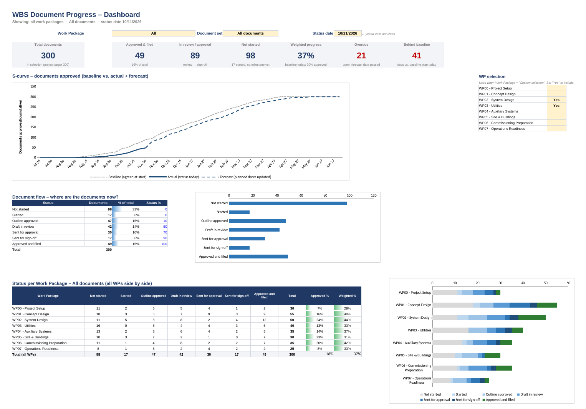

# Project Document Dashboard – WBS Document Progress

A live project dashboard for a WBS document tracker, built **inside the Excel workbook itself** with Office Scripts. No add-ins and no external services: all data stays in your own Microsoft 365 environment.

*A self-directed learning project: built to explore Office Scripts, Excel formulas for project control (S-curves, baseline vs. forecast) and how to hand a tool over to someone else with a rollout guide and a Copilot prompt.*



## What it shows

- **KPI tiles:** total documents, approved & stored, in review/approval, not started, weighted progress, overdue, behind baseline
- **S-curve:** baseline (agreed at start) vs. actual (status today) + forecast (planned dates updated), drawn as one continuous line
- **Document flow:** number of documents per workflow status
- **Status per work package** (all WPs side by side) and **per document set** (e.g. Key deliverables)
- **Attention list:** open documents whose forecast approval date has passed, with owner and days late

All of these follow three filters on the dashboard:

| Filter | Options |
| --- | --- |
| Work Package | All · one WP · *Custom selection* (several WPs, ticked in a side panel) |
| Document set | All documents · Key deliverables · any set defined as a Yes/No column |
| Status date | Today by default; overwrite it to see an earlier status (see note below) |

> **Note on the status date.** Figures based on dates follow the status date: *Approved & filed*, *Overdue*, *Behind baseline*, the S-curve and the attention list. Figures based on the current *Status* column do not: *In review / approval*, *Not started*, *Weighted progress*, the document flow and the status matrices always show the status as it is now. For a true look back at those, use the weekly snapshots in *PM History*.

## Repository layout

| Path | Content |
| --- | --- |
| `demo/WBS_Document_Dashboard_DEMO.xlsx` | Finished dashboard on **300 fictitious documents**. Start here. |
| `office-scripts/Build_PM_Dashboard.ts` | Builds the dashboard tabs in your own workbook (Excel → Automate → New Script) |
| `office-scripts/Archive_Weekly_Snapshot.ts` | Stores weekly status counts in a *PM History* tab; can be scheduled with Power Automate |
| `copilot/Copilot_prompt_PM_Dashboard.md` | Prompt to let Copilot in Excel build the same dashboard, plus follow-up questions |
| `docs/ROLLOUT_GUIDE.md` / `.pdf` | Step-by-step rollout guide for the project manager |
| `docs/images/` | Screenshots of the demo dashboard and the S-curve |
| `tools/generate_demo/` | Python scripts that regenerate the demo workbook |

## Quick start

1. Open `demo/WBS_Document_Dashboard_DEMO.xlsx` and try the yellow filter cells on the *Dashboard* tab.
2. In your real workbook: format the document list as a table named `tblDocuments` (Ctrl+T).
3. Make sure it has a **Baseline approval date** and a **Forecast approval date** per document.
4. Excel → **Automate → New Script** → paste `office-scripts/Build_PM_Dashboard.ts`.
5. Adjust `COL` and `SETS` at the top of the script to your column names, then **Run**.

The full procedure, checks and troubleshooting are in [docs/ROLLOUT_GUIDE.md](docs/ROLLOUT_GUIDE.md).

## Requirements

- Excel for Microsoft 365 (desktop or web) with Office Scripts enabled
- The workbook stored in OneDrive or SharePoint
- Optional: Power Automate (Excel Online (Business) → *Run script*) for the weekly snapshot and e-mail

## Regenerating the demo workbook

```bash
pip install openpyxl
python tools/generate_demo/build_demo.py
```

This rewrites `demo/WBS_Document_Dashboard_DEMO.xlsx` with the same fictitious data (fixed random seed, status date 10 Nov 2026). Excel calculates all formulas when the file is opened.

## Data policy

This repository contains **no real project data**. Document IDs, titles, owners and dates in the demo are generated. Do not commit real tracker files, exports, screenshots or recordings: the `.gitignore` blocks common file types outside `demo/` as a safeguard.

## Status

| Part | Status |
| --- | --- |
| Demo workbook | Formulas verified against an independent calculation for several filter combinations |
| Office Scripts | Type-checked against the official ExcelScript API definitions; **not yet run in Excel**. Test on a copy first. |

## License

[MIT](LICENSE) – free to use and adapt; no warranty.
